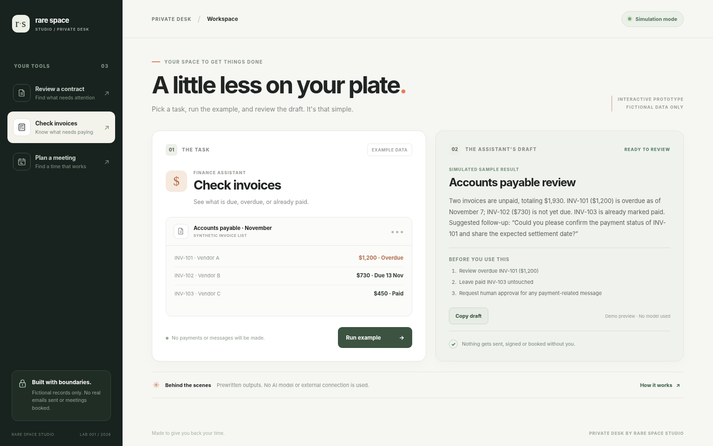
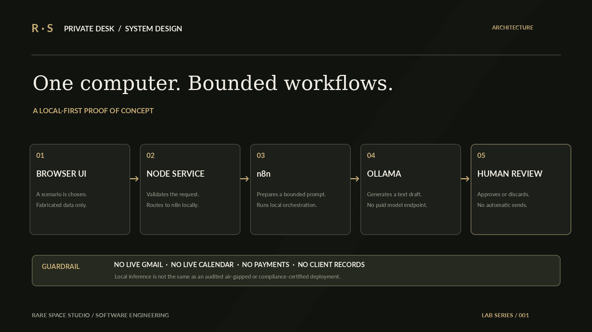

# Private Desk · Rare Space Studio

**[Try the public demo](https://rare-space-private-desk.xbbnkwb722.chatgpt.site/)**

Private Desk is a local-first assistant prototype by Rare Space Studio for contract review, invoice triage, and scheduling. The public demo uses fictional records and prewritten results. Every output is a draft for human review.



## What you can try

| Workflow | What the demo shows |
|---|---|
| Contract review | Flags the short termination notice, missing governing law, and unclear confidentiality duration in a fictional agreement. |
| Invoice triage | Separates overdue, upcoming, and paid sample invoices and drafts a follow-up. |
| Scheduling | Suggests two open slots from a fictional calendar and drafts a confirmation for review. |

All three workflows were tested on the public demo at desktop and mobile widths. The static dashboard in [`docs/`](docs/) runs in the browser without a sign-in or model service. It cannot send messages, pay invoices, or book appointments.

## Run locally in simulation mode

With Node.js 22 or later:

```sh
git clone https://github.com/PapiDee09/private-desk.git
cd private-desk
node app/server.mjs
```

Open [http://localhost:3105](http://localhost:3105) on the same computer, choose a workflow, and select **Run example**. The Node server binds to loopback by default. See [local port assignments](PORT-OWNERSHIP.md).

## Local AI mode

The included Docker Compose stack keeps its published ports bound to loopback. Copy `.env.example` to `.env`, replace the placeholder encryption key with a generated secret, and run `docker compose up -d --build`. Pull a small model with `docker compose exec ollama ollama pull qwen2.5:0.5b`. In local n8n, import `workflows/rare-space-private-desk.json` and activate the workflow. Set `DEMO_MODE=live` in the local environment and recreate only the dashboard with `docker compose up -d --force-recreate dashboard`.

In local AI mode the dashboard calls the Node.js API, which sends the synthetic task to the n8n webhook. The workflow requests a draft from Ollama and returns it to the UI for human review. Keep those services local. The live n8n–Ollama path was not verified end to end for this public release.

## Tests and architecture

Run `node --test tests/*.test.mjs`. The tests cover the simulation, local HTTP endpoints, workflow structure, responsive CSS, and port isolation. The local AI test checks configuration and workflow code only.


